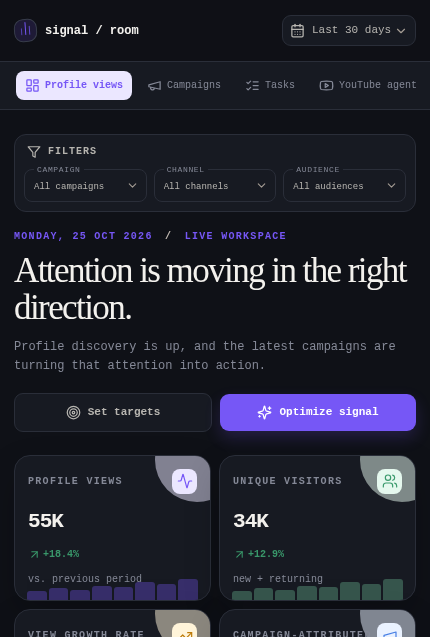

# ProfileDash

ProfileDash is a campaign intelligence workspace for creator teams. It brings profile growth, campaign performance, and a YouTube research agent into one focused dashboard so teams can move from signal to action without stitching together spreadsheets.



## What is here

- Profile and campaign performance views with responsive dark-mode UI.
- YouTube agent workspace for research, comment sync, summaries, and follow-up tasks.
- Server-backed tRPC APIs with Drizzle and Neon Postgres support.
- Automated CI for typechecking and static production builds.

## Run locally

```bash
pnpm install --frozen-lockfile
cp .env.example .env
pnpm dev
```

The app honors `PORT` and defaults to `3000`.

## Commands

| Command | Purpose |
| --- | --- |
| `pnpm dev` | Start the full development server |
| `pnpm build` | Build the client and bundled server |
| `pnpm start` | Serve the production build |
| `pnpm check` | Run TypeScript checks |
| `pnpm test` | Run Vitest tests |
| `pnpm build:static` | Build the static dashboard |
| `pnpm db:migrate` | Apply checked-in database migrations |

## Agent workflows

Agent tasks are persisted in Neon and queued through Upstash QStash when `QSTASH_TOKEN` is configured. The workflow endpoint is `POST /api/agent/tasks/start` with `{ "instruction": "..." }`; QStash delivers the signed execution request to `/api/agent/tasks/:taskId/run`. Without QStash credentials, local development starts the Workflow SDK run directly. Task status, current step, result, error, and workflow run ID remain in Neon.

Required workflow variables are listed in `.env.example`: `QSTASH_URL`, `QSTASH_TOKEN`, `QSTASH_CURRENT_SIGNING_KEY`, `QSTASH_NEXT_SIGNING_KEY`, and `REDIS_URL` when your Upstash setup uses Redis-backed state.

## Configuration and security

`.env.example` documents the required runtime configuration without containing credentials. Copy it to `.env` for local development; `.env` and other environment files are ignored by Git. Private keys remain server-side and public runtime values are explicitly allowlisted in `server/_core/publicConfig.ts`.

See [SECURITY.md](SECURITY.md) for the vulnerability reporting and secret-handling policy. The project is licensed under the [MIT License](LICENSE).

## Status

ProfileDash is an early-stage product under active development. The repository's CI workflow runs on pushes and pull requests to `main`; releases will be added once the core workflows are stable.
